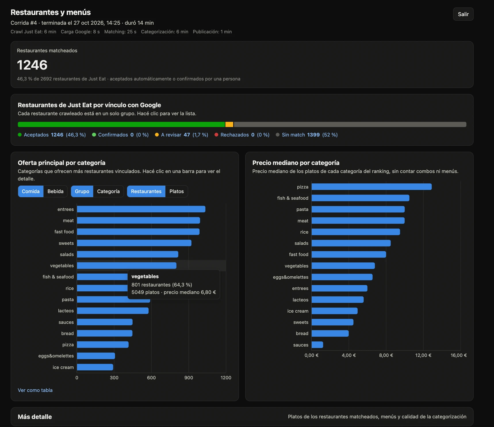
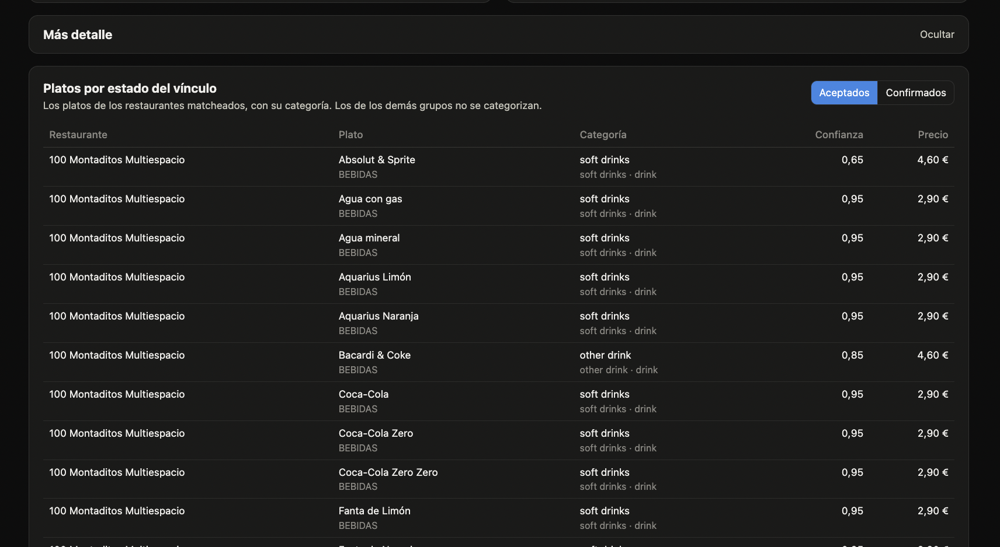
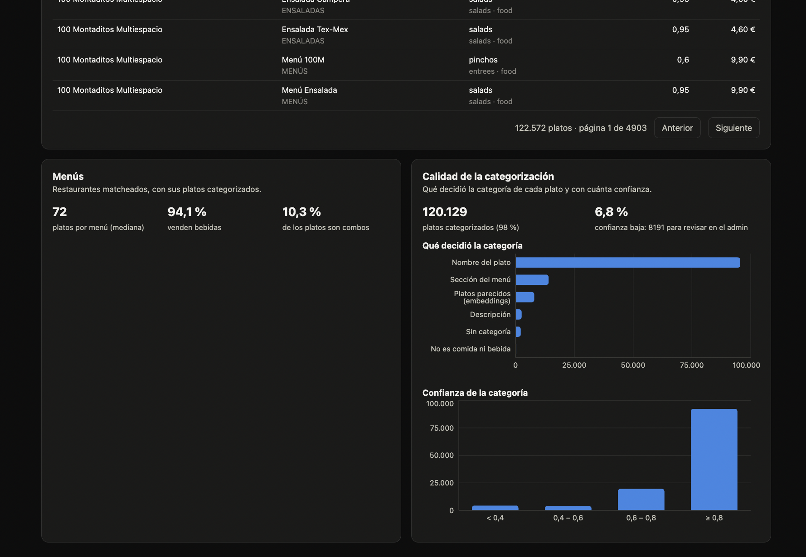

# Restaurantes y menús: pipeline de datos y dashboard

El sistema **obtiene** los restaurantes y menús de Just Eat, los **vincula** con su ficha de Google,
**clasifica** cada plato en una taxonomía estándar y **muestra** los resultados en un dashboard.

```
 1. Obtener        2. Cargar         3. Vincular          4. Clasificar        5. Publicar
 Just Eat     ──►  Google       ──►  Just Eat ↔ Google ──► platos en      ──►  todo junto, en un
 (2.696 locales)   (21.926 fichas)   (reglas explicables)  101 categorías       solo paso  ──► Dashboard
```

El detalle de cada etapa, con sus mediciones y las 39 decisiones tomadas, está en
[`docs/decisiones.md`](docs/decisiones.md).

---

## Puesta en marcha

**Requisitos:** Docker y Docker Compose. Copiar los archivos de entrada a `./data/`: `google_venues.json` y
`food_categories.xlsx`. La carpeta se monta en solo lectura y no forma parte del repositorio.

```bash
docker compose up --build                                    # base de datos, Redis, web, worker y planificador
docker compose exec web python manage.py createsuperuser     # usuario para el panel y el dashboard
```

**Correr el pipeline.** Cada día a las 06:00 se procesan las corridas pedidas. Para correr una en el momento:

```bash
docker compose exec web python manage.py start_pipeline --now              # completa
docker compose exec web python manage.py start_pipeline --limit 20 --now   # solo 20 restaurantes, para probar
```

El avance de cada corrida y de cada paso, con sus métricas y errores, se ve en el panel:
`http://localhost:8000/admin/` → *Corridas*.

**Abrir el dashboard:** `http://localhost:8000/`. Entran los superusuarios y los usuarios del grupo
**"Dashboard"**, que se agregan desde el panel y solo pueden ver.

<details>
<summary>Sin Docker (Python 3.13, Node 24, PostgreSQL 16 y Redis propios)</summary>

```bash
cp .env.example .env                                   # y ajustar las URLs de la base y de Redis
python3.13 -m venv .venv && .venv/bin/pip install -e ".[dev]"
.venv/bin/python src/libs/categorization/download_model.py   # modelo de clasificación (versión fija, verificada)
(cd frontend && npm ci --ignore-scripts && npm run build)
.venv/bin/python manage.py migrate
.venv/bin/python manage.py runserver                   # web: panel y dashboard
.venv/bin/celery -A config worker -l INFO              # en otra terminal: ejecuta los pasos
.venv/bin/celery -A config beat -l INFO                # en otra terminal: corridas diarias
.venv/bin/pytest && (cd frontend && npm test)          # tests
```
</details>

---

## Decisiones de arquitectura

| Decisión | Por qué |
|---|---|
| **Django + PostgreSQL** como base, con un **panel de administración** para seguir las corridas y revisar resultados. | Tecnología probada, con usuarios, permisos y panel incluidos; el equipo revisa sin depender de desarrollo. |
| **Corridas registradas en la base y procesadas por una cola de tareas** (Celery + Redis). Cada paso encola al siguiente. | Una corrida pedida no se pierde aunque se caiga un servidor, y su estado y sus errores quedan a la vista. |
| **Tablas auxiliares por corrida y un paso final de publicación.** | Lo que ven el panel y el dashboard es siempre una corrida completa, nunca una a medias. |
| **Lógica de negocio en librerías independientes**, sin dependencias del framework, en [`src/libs/`](src/libs/): crawler, matching y clasificación. Las apps de Django ([`src/apps/`](src/apps/)) las usan como herramientas. | Se prueban por separado y se pueden reutilizar o reemplazar sin tocar el resto. |
| **Reglas de negocio explícitas, en un solo lugar:** en cada librería, los valores fijos (vocabularios, umbrales) en `constants.py` y la lógica que los aplica en `*_business_rules.py`. | Se pueden consultar y auditar sin leer el resto del código, y cada cambio de una regla se mide con los tests de calidad. |
| **Dashboard en React sobre una API REST de solo lectura**, servido por el mismo Django. | Las cuentas se hacen en el servidor, cerca de los datos y con tests; la página solo dibuja. Comparte el login del panel. |
| **Sin modelos de lenguaje externos (LLM).** La clasificación corre en el propio servidor. | Sin costo por uso y sin enviar menús a terceros, y cada resultado se puede explicar. |

## Cómo garantizamos que sea robusta

- **Nada a medias.** Cada paso trabaja sobre los datos de su propia corrida. Recién al final, si todos los
  pasos salieron bien, los resultados se publican juntos en una sola operación. Si algo falla, el panel y el
  dashboard siguen mostrando la última corrida buena.
- **Integridad de los datos.** Un paso solo usa lo que produjeron los pasos anteriores de la misma corrida. No
  se pueden saltear pasos ni cargar archivos de afuera. Los archivos de entrada se validan enteros: un registro
  inválido rechaza el archivo, y su huella digital queda registrada en la corrida.
- **Las decisiones de las personas mandan.** Un vínculo confirmado o rechazado, o un plato corregido a mano,
  nunca lo pisa una corrida, aunque la decisión se haya tomado mientras la corrida estaba en curso.
- **Fallas controladas.**
  - Un restaurante que falla se anota y la corrida sigue con el resto.
  - Una corrida trabada se corta por tiempo y queda marcada como fallida.
  - Para reintentar se crea una corrida nueva; nunca se retoma una a medias.
  - Los datos de una corrida fallida se guardan 7 días para diagnosticar.
- **Memoria bajo control.** Cada paso corre en un proceso nuevo y con un tope de memoria, así un error no puede
  tumbar el servidor. Ese tope surgió de un caso real, que quedó corregido y cubierto por un test.
- **Calidad medida, no supuesta.** El matching y la clasificación se miden contra casos revisados a mano, y esas
  mediciones son tests: si un cambio empeora los resultados, los tests fallan. Hay unos 300 tests en total,
  entre unitarios, de comportamiento (BDD) y del frontend.
- **Seguridad.**
  - Secretos solo por variables de entorno; la app no arranca en producción sin ellos, y fuerza HTTPS.
  - Dashboard con login, con bloqueo tras intentos fallidos, y API de solo lectura con parámetros validados.
  - Contenedores sin permisos de administrador del sistema.
  - Dependencias con versión fija y verificadas.

---

## Vincular Just Eat con Google (matching)

**El problema:** el mismo local aparece con nombres y direcciones escritos distinto. "Goiko Gran Vía" y
"GOIKO", por ejemplo, o una dirección en castellano y otra en catalán. A la vez, en un centro comercial hay
decenas de locales en la misma dirección.

**Cómo lo resolvemos**, como lo haría una persona:

1. **Mirar solo lo cercano:** para cada restaurante, las fichas de Google a menos de 400 m.
2. **Comparar el nombre dándole peso a lo distintivo:** compartir "Goiko" dice mucho; compartir "restaurante"
   o "sushi" no dice nada. Se toleran errores de tipeo y palabras juntas o separadas.
3. **Confirmar con la dirección:** misma calle y mismo número, en cualquier idioma.
4. **Decidir con reglas claras:**
   - **Vinculado:** nombre distintivo y muy parecido, cerca o en la misma dirección.
   - **A revisar:** probable pero dudoso. Una persona lo confirma o lo rechaza en el panel.
   - **Sin vínculo:** si no hay evidencia, no se inventa. Nunca se vincula solo por la dirección.
5. **Uno a uno:** cada ficha de Google se asigna a un solo restaurante, empezando por los casos más seguros.

**Resultados** (medidos contra 200 restaurantes revisados a mano):

| Indicador | Valor | En palabras |
|---|---|---|
| Precisión | **100%** | Ningún vínculo automático equivocado. |
| Cobertura | **92%** (94% con los "a revisar") | De los restaurantes que sí tienen ficha en Google, se vinculan solos 9 de cada 10. |

Alrededor de la mitad de los restaurantes de Just Eat no tiene ficha en el archivo de Google: supermercados,
marcas que solo existen en delivery y locales fuera de la zona cubierta.

## Clasificar los platos

**El problema:** los menús son texto libre, en varios idiomas y con formatos muy distintos, y hay que llevar
cada plato a una de las 101 categorías estándar (por ejemplo *pizza → pizza → comida*).

**Cómo lo resolvemos**, en capas que van de lo más seguro a lo más aproximado:

1. **Reglas de palabras** en castellano, catalán e inglés, que piensan como una persona:
   - **El tipo de plato manda sobre el ingrediente:** "Ensalada de salmón" es una ensalada.
   - **Lo que viene después de "con" o "+" es acompañamiento:** "Pollo con patatas + bebida" es pollo.
   - **La sección del menú ayuda:** "Carbonara" en la sección "Pizzas" es una pizza.
   - **Un combo se clasifica por su plato principal.**
2. **Platos parecidos:** lo que las reglas no resuelven ("Shia Chiao", "Veg Jalfrezi") se compara con platos
   que ya se clasificaron con seguridad y toma la categoría de los más parecidos. Corre en el propio servidor.
3. **Todo, en cada corrida:** se clasifican todos los platos de los restaurantes vinculados (unos 122.000, en
   unos 5 minutos).
4. **Transparencia:** cada plato guarda **qué lo decidió y con cuánta confianza**. Los de confianza baja se
   filtran en el panel, y una persona puede corregirlos. La corrección se respeta en las corridas siguientes.

**Resultados** (200 platos al azar, revisados a mano sin mirar lo que decía el sistema):

| Nivel | Acierto |
|---|---|
| Familia (comida o bebida) | **95%** |
| Grupo (ej. *pizza*, *carnes*) | **82%** |
| Categoría exacta | **79%** |

Los errores típicos son palabras ambiguas ("Lomo de atún" sale como cerdo) y platos de cocinas poco
representadas. Sumar vocabulario a las reglas es la mejora más barata.

---

## El dashboard

Muestra la **última corrida publicada**:

- **Lo pedido, a la vista:**
  - **Restaurantes matcheados** (aceptados automáticamente o confirmados por una persona) sobre el total.
  - Los restaurantes en sus cinco grupos: aceptados, confirmados, a revisar, rechazados y sin match. Un clic en
    cada grupo abre su lista.
  - **Oferta principal por categoría:** ranking por cantidad de restaurantes o de platos, comida o bebida, con
    precio mediano. Un clic en una categoría muestra su detalle.
- **Más detalle**, plegado al abrir la página; sus datos se piden recién al desplegarlo:
  - Los platos de los restaurantes matcheados, con su categoría, confianza y precio.
  - Tamaño de los menús, cuántos venden bebidas y cuántos platos son combos.
  - Calidad de la clasificación: qué decidió cada categoría y con cuánta confianza.

### Screenshot

La vista principal, con "Más detalle" plegado al final:



"Más detalle" desplegado: los platos de los restaurantes matcheados, con su categoría, confianza y precio,



y los menús y la calidad de la categorización:



**Resultados de la última corrida completa (#4 de docker compose, 27/10/2026, 14 minutos):**

| | |
|---|---|
| Restaurantes obtenidos de Just Eat | 2.692 de 2.696 (4 ya no existen) |
| Tiempo por paso | Crawl de Just Eat 6 min (antes 12, con 10 pedidos en paralelo en vez de 4), carga de Google 8 s, matching 25 s, categorización 6 min, publicación 1 min |
| Vinculados con Google | **1.246 (46%)**, más 47 a revisar; 1.399 sin ficha en Google |
| Platos clasificados | **120.129 de 122.572 (98%)**; 8.191 (6,8%) con confianza baja, para revisar |
| Lo que más ofrecen los restaurantes | Entrantes (83%), carnes (80%), comida rápida (79%) y postres (74%) |
| Otros hallazgos | El 94% vende bebidas; un menú tiene 72 platos (mediana); el 10% de los platos son combos |

## Limitaciones y próximos pasos

- **Sin historia entre corridas:** se muestra la última. Guardar una foto de las métricas al publicar permitiría
  ver la evolución.
- **Revisión de negocio pendiente:** falta que negocio revise las muestras usadas para medir (200 vínculos y
  600 platos), que preparó el equipo técnico.
- **Platos con varios tamaños:** se guarda el precio del primer tamaño, como en el archivo de referencia.
